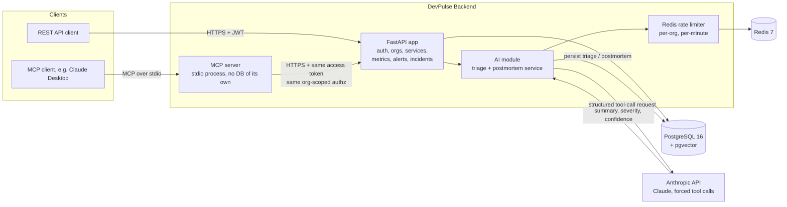

# DevPulse

DevPulse is an engineering-ops backend that tracks services, metrics, alerts, and incidents for an organization, then hands that incident data to Claude for triage and postmortem drafting, both through a REST API and through a native MCP server so any MCP client (Claude Desktop included) can query and act on the same data. It is not a demo wrapped around a chatbot: it has org-scoped auth, Redis-backed rate limiting on every paid AI call, pagination on every unbounded list endpoint, a prod-safe secret guard, and a test suite that spins up real Postgres and Redis containers instead of mocking the database away.


## What it does

DevPulse models the core of an incident-management tool (think a small internal PagerDuty slice): organizations and members, services, metrics, alert rules and alert events, and incidents with a status lifecycle. On top of that it adds an AI layer backed by the Anthropic API:

- **Incident triage.** Claude reads an incident's title, severity, status, linked service, and description, and returns a structured summary, a suggested severity, and a confidence score, enforced through a forced tool call rather than parsed from freeform text. Every run is appended to an `incident_triages` table, so an incident keeps a full triage history, not just the latest guess.
- **Postmortem generation.** Claude drafts a postmortem strictly from the incident's recorded facts (timestamps, severity, linked service, full triage history) and is explicitly instructed to say "the data doesn't support a root cause" rather than invent one. Every draft is persisted, same as triage.
- **MCP server.** A separate process (`backend/mcp_server/`) exposes incidents, services, triage, and postmortems as MCP tools, so a model talking over the Model Context Protocol can list incidents, create one, trigger a triage, or pull a postmortem, all through the same authenticated REST API everything else uses.

## Architecture



The MCP server deliberately holds no database connection of its own. Every tool call it makes is a plain HTTP request against the already-running API, so it inherits the exact same org-membership authorization as any other client instead of duplicating that logic in a second place.

## Features

- Org-scoped auth with argon2id password hashing and JWT access tokens.
- Services, metrics, alert rules, alert events, and incidents, each with its own router, service layer, and SQLAlchemy models.
- Claude-backed incident triage with a persisted history (`incident_triages`), driven by a forced tool call so the response shape never depends on how the model phrases things.
- Claude-backed postmortem generation, grounded only in recorded incident facts, with a persisted history (`postmortems`).
- An MCP server (`devpulse-mcp`) exposing `list_incidents`, `get_incident`, `create_incident`, `update_incident_status`, `triage_incident`, `list_incident_triages`, `generate_postmortem`, `list_postmortems`, and `list_services` as MCP tools.
- Every unbounded list endpoint (incidents, services, alert events, metrics) returns `{items, total, limit, offset}` instead of a bare array; small, human-bounded collections (org members, alert rules) intentionally stay as plain lists.
- A Redis-backed, fixed-window rate limit shared by triage and postmortem generation, scoped per organization per minute, returning `429` with `Retry-After` when exceeded.
- An explicit Anthropic request timeout and retry count instead of the SDK's 600 second default, so a stalled Claude call can't hold a database session open for minutes.
- A prod secret guard: `Settings` refuses to construct when `APP_ENV=prod` and the JWT signing secret is still a default, a placeholder, or under 32 characters.

## Tech stack

| Layer | Technology |
| --- | --- |
| API | FastAPI, Python 3.12, Pydantic v2 |
| Database | PostgreSQL 16 with pgvector, SQLAlchemy 2.0 (async), Alembic migrations |
| Cache / queue | Redis 7, arq, APScheduler |
| Auth | argon2id (argon2-cffi), PyJWT |
| AI | Anthropic SDK (forced tool calls), MCP Python SDK |
| Testing | pytest, pytest-asyncio, testcontainers (real Postgres/Redis in CI), freezegun |
| Tooling | ruff, mypy (strict), uv, Docker Compose, GitHub Actions |
| Logging | structlog (structured JSON) |

Frontend (React 18, TypeScript, Vite, shadcn/ui) is planned for a later phase and is not implemented yet, so there is no UI to screenshot today; everything above is exercised through the REST API, the test suite, and the MCP server.

## Running it locally

Requirements: Docker, Docker Compose v2, GNU Make.

```bash
cp .env.example .env       # then edit secrets, including ANTHROPIC_API_KEY
make up                    # starts postgres, redis, api
curl http://localhost:8000/healthz
make logs                  # tail container logs
make down                  # stop everything
```

Tests, lint, and type-check:

```bash
make test
make lint
make typecheck
```

Or without Docker, from `backend/` with [uv](https://docs.astral.sh/uv/):

```bash
cd backend
uv sync --extra dev
uv run ruff check .
uv run ruff format --check .
uv run mypy app
uv run pytest --cov=app --cov-report=term-missing --cov-report=html
```

Integration tests spin up ephemeral Postgres and Redis containers via [testcontainers](https://testcontainers-python.readthedocs.io/), so Docker needs to be running, but no manual setup or secrets are required for them.

To run the MCP server against a running API:

```bash
cd backend
uv sync --extra dev
DEVPULSE_MCP_ACCESS_TOKEN=<a valid access token> \
DEVPULSE_MCP_ORG_ID=<the org to scope every call to> \
uv run devpulse-mcp
```

## What's technically interesting here

- **Forcing structure out of an LLM, not parsing it out.** Both triage and postmortem generation use Anthropic's tool-call mechanism to force Claude into a fixed response shape (`summary`, `suggested_severity`, `confidence` for triage) instead of asking for JSON in a prompt and hoping. That removes an entire class of "the model added a markdown fence around its JSON" bugs that string-parsed LLM integrations tend to hit in production.
- **An MCP server with no database of its own.** Rather than building a second data-access layer for MCP clients, `mcp_server/` is a thin stdio process that calls the real API over HTTP using a real access token. That one design choice means the authorization rules (who can see which org's incidents) only exist in one place, and the MCP surface can never drift out of sync with the REST API's behavior as the product grows.
- **Treating the Claude API as a cost center, not just a feature.** The rate limiter, the explicit request timeout (overriding the SDK's 600-second default), and the retry count are all aimed at one failure mode that most AI side-projects never think about: a bug or an abusive client quietly running up real money against a paid API while holding database connections open. Those three pieces plus the prod secret guard are the difference between "AI demo" and "AI feature with a production incident budget."

## Project status

| Phase | Area | Status |
| --- | --- | --- |
| Phase 1 | Core backend (auth through incidents) | Done |
| Phase 2 | AI layer (Claude triage, MCP, RAG) | In progress: triage, postmortems, and the MCP server are shipped; RAG is next |
| Phase 3 | Frontend | Not started |
| Phase 4 | Production infrastructure (AWS) | In progress: pagination, rate limiting, Claude timeouts/retries, and the prod secret guard are shipped; deployment and observability are next |
| Phase 5 | Polish, docs, demo | Not started |

See [docs/adr/](docs/adr) for the architecture decision records behind these choices.
